

  

 

  

 

## Verdict board

  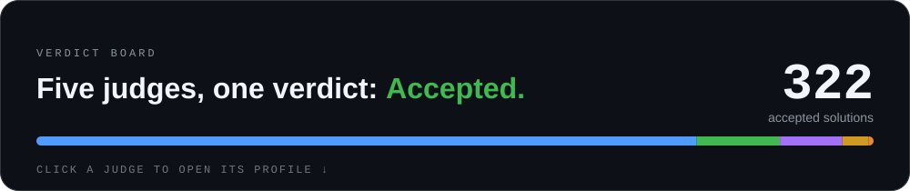 
  <a href="https://codeforces.com/profile/USERNAME"></a> 
  <a href="https://cses.fi/user/USER_ID"></a> 
  <a href="https://toph.co/p/USERNAME"></a> 
  <a href="https://atcoder.jp/users/USERNAME"></a> 
  <a href="https://leetcode.com/u/USERNAME"></a>

  

 

## Codeforces ladder

  

 

  

